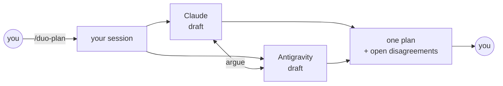
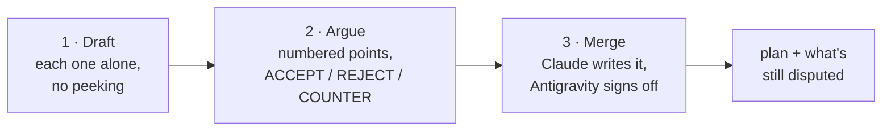
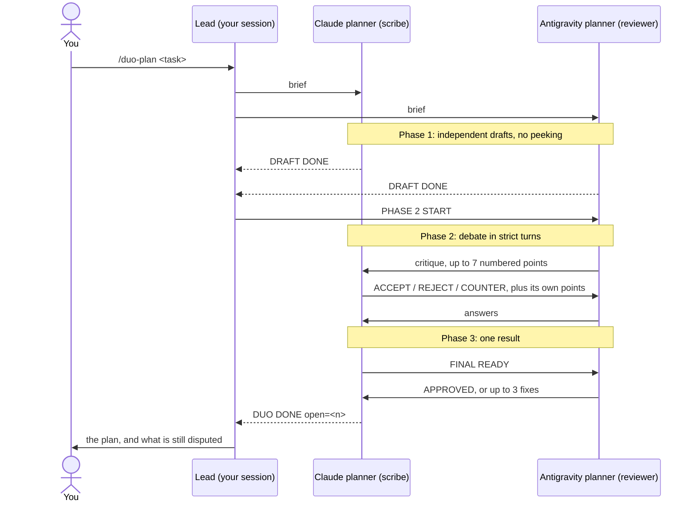

# duo-agents

Ask one AI for a plan and you get a confident plan. Ask it again and you get the same plan, with
the same holes. Different vendors have different blind spots, so this repo puts two of them on
the same task and lets them fight it out.

<p align="center"></p>

You type one command. A Claude Code planner and an Antigravity (Gemini) planner each write a draft
without seeing the other's, then they swap drafts and pick them apart point by point. You get one
plan back, and a short list of the things they still disagree on. Those are the calls worth your
time.

```
/duo-plan add rate limiting to the public API
/duo-ask  why does the nightly export time out in production?
```

`/duo-plan` gives you a plan file. `/duo-ask` is the same thing for questions: the answer comes
back in the chat. Both work from Claude Code or from Antigravity, and both run as tabs in
Herdr, so you can watch the argument live. macOS only for now.



## Install

```sh
git clone https://github.com/GaetanoPiazzolla/duo-agent.git && cd duo-agent
./install.sh
```

Needs `hc` (Herdr), `claude` and `agy` on your `PATH`. The installer tells you which are missing.

| Option | What it does |
| --- | --- |
| `--link` | Symlink the skills to this checkout instead of copying, so `git pull` updates them |
| `--claude-dir <dir>` | Also install into another Claude Code config dir (repeatable) |
| `--uninstall` | Remove everything the installer created |

Running it again is safe. `./test.sh` runs the installer against a throwaway `HOME`.

## How it works

Three rounds, always in the same order:



The argument is capped: two rounds each, at most 7 points per message. Whatever is not settled by
then stops being argued and goes to you. The full exchange looks like this:



- The **lead** is the session you typed the command into. It writes the brief, moves the planners
  from one round to the next and hands you the result. It never writes any of the plan itself, so
  it can't steer them toward its own idea.
- The planners open as **tabs in your Herdr space**. Click over and watch them argue.
- Anything they can't settle lands under `## Open disagreements`, with both sides. Those are your
  decisions.

## What ends up in your project

```
your-project/
├── .duo-plan/               # working folder, ignores itself in git
│   └── rate-limiting/
│       ├── brief.md         # what the lead asked for
│       ├── claude.md        # Claude's independent draft
│       ├── agy.md           # Antigravity's independent draft
│       ├── msg-*.md         # the longer debate messages
│       └── final.md         # the merged result
└── rate-limiting-plan.md    # /duo-plan only: the copy you keep
```

When you accept or drop the result, the lead closes both planners and deletes the working folder.
`/duo-ask` answers in the conversation and leaves nothing behind.

## What gets installed

| Path | Purpose |
| --- | --- |
| `~/.agents/skills/duo-plan`, `duo-ask` | The skills, the planner protocol and the planners' permissions |
| `~/.claude/skills/duo-*` | Symlinks that give Claude Code the slash commands (every profile found) |
| `~/.gemini/config/skills/duo-*` | Symlinks that give Antigravity the slash commands |
| `~/.config/herdr-core/templates/duo-claude.md`, `duo-agy.md` | How Herdr starts each planner |

## Permissions

The planners run unattended, so each one works the way its own CLI's auto mode allows:

- **Claude planner**: starts with the settings of the Claude account you launched from, so it has
  the permission mode and allow rules you already use, plus `hc send` and writing inside
  `.duo-plan/`. See `skills/duo-plan/claude-planner-settings.json`.
- **Antigravity planner**: runs with `--mode auto`. Commands run in Antigravity's sandbox without
  asking, and risky or irreversible ones still stop for approval. `hc send` and the usual read
  commands are allowed outright in `skills/duo-plan/agy-planner-settings.json`. Auto mode is not
  offered on business and enterprise Google accounts: use `--mode accept-edits` in
  `templates/duo-agy.md` there, and expect a prompt for anything outside the allowlist.

Both are told to write only inside `.duo-plan/`. For Antigravity that is an instruction, not an
enforced limit. Whatever still needs approval stops on a prompt in that planner's tab, and the lead
tells you.

## Good to know

- **Trust dialog.** The first time Claude Code or Antigravity opens a project, it asks whether you
  trust the folder. Answer it in the planner's tab; the lead will not answer it for you.
- **Several Claude accounts.** The Claude planner uses the same `CLAUDE_CONFIG_DIR` as the session
  you started from. Profiles in `~/.claude-*` are detected at install time.
- **The lead asks before running `hc`.** Allow `hc` in your agent's settings if you want it to run
  the whole flow without prompts.
- **Roles are fixed.** Claude writes the final file and Antigravity reviews it, whichever of the two
  is the lead.
- **Models.** Pinned in the `command:` line of each template in `templates/`: `opus` for the Claude
  planner, `gemini-pro-orchestrator-neon` for the Antigravity one. Antigravity can also run Claude
  models, so keep a Gemini one there or both planners share the same blind spots. Run the installer
  again after changing a template.

## Repository layout

```
skills/duo-plan/SKILL.md              # what the lead does
skills/duo-plan/planner-protocol.md   # what the planners do
skills/duo-plan/bin/duo-claude        # starts the Claude planner on the right account
skills/duo-ask/SKILL.md               # /duo-ask: same process, answer instead of plan
docs/duo.svg, make-demo.py            # the animation above, and the script that draws it
templates/                            # Herdr templates, rendered by the installer
install.sh  test.sh
```
